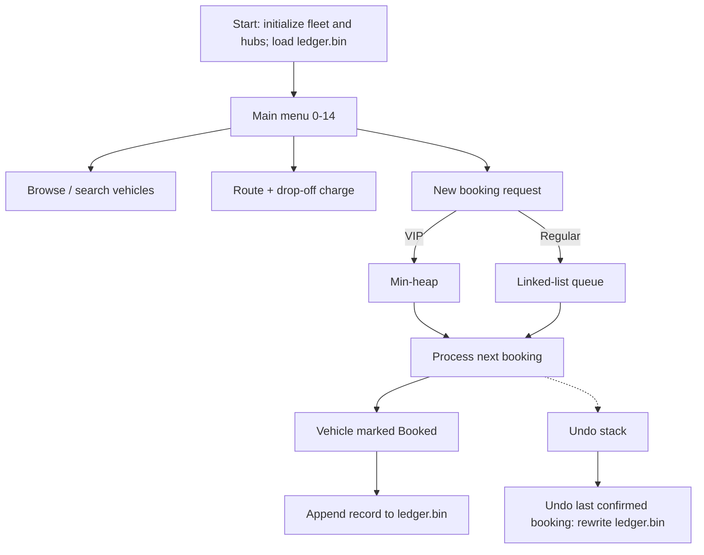
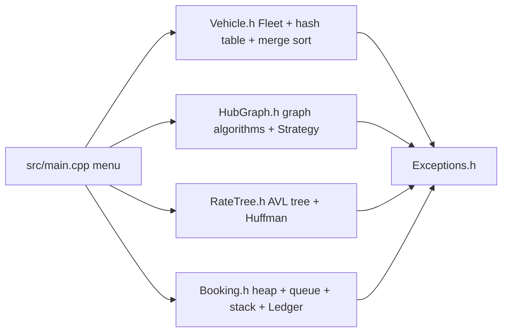
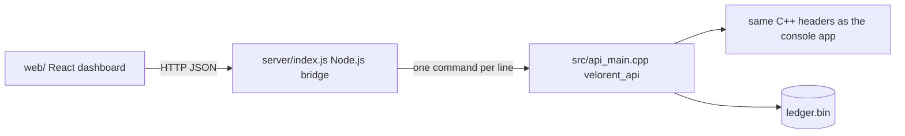

# VeloRent — Smart Vehicle Rental Management System

## 1. Project Title and Introduction

**Team The Hamsters** · B.Tech CSE, Semester III · Graphic Era (Deemed to be University), Dehradun
Combined PBL: **TCS302 Data Structures** + **TCS307 Object-Oriented Programming with C++**
Repository: https://github.com/rakesh07-dev/VeloRent

> **Phase 3 status:** the four modules are joined in one console menu (`src/main.cpp`) and covered by 91 automated checks. An optional web dashboard (`web/`) talks to the same C++ code through a small Node.js bridge (`server/`).
> Remaining gaps are listed honestly in [Current Implementation Status](#18-current-implementation-status).

VeloRent is a console-based vehicle rental system built to apply Data Structures (TCS302) and OOP in C++ (TCS307) on one realistic problem.

---

## 2. Project Overview

VeloRent models a multi-city vehicle rental company. A customer can browse the fleet, find a vehicle, pick pickup and drop hubs, get the cheapest route and the drop-off charge, and make a booking. VIP bookings are served first, the last booking can be undone, and confirmed bookings are saved to a file.

The core is a **C++14 console application** with no database and no third-party library. Most data structures (hash table, AVL tree, heap, linked-list queue and stack, Huffman tree) are written by hand; the STL is used for `vector`, `unordered_map`, `priority_queue` and `sort` in the graph and Huffman code.

An **optional web dashboard** sits on top of the same C++ code. It does not re-implement any logic: a Node.js (Express) bridge in `server/` starts a second C++ program, `velorent_api` (`src/api_main.cpp`), which reuses the same headers and talks to the bridge with one command per line and one JSON reply per line. The web part uses npm packages (Express, CORS, and a React front end in `web/`); the C++ part does not.

## 3. Key Features

- Vehicle hierarchy: `Car`, `Bike`, `ElectricVehicle`, `LuxuryBus` (inheritance and polymorphism).
- Fast VIN and plate lookup with a custom hash table; fleet sorted by rate with merge sort.
- Price-range search with an AVL tree.
- Hub network with shortest route (Dijkstra), all-pairs distances (Floyd-Warshall), minimum spanning tree (Kruskal and Prim), reachability (BFS, DFS), Bellman-Ford.
- Drop-off charge chosen at run time with the Strategy pattern.
- VIP min-heap, regular queue, undo stack.
- Bookings saved in a binary file (`ledger.bin`).
- Huffman compression of receipt text.
- Custom exception hierarchy and input validation for handling invalid user input and file errors.
- A vehicle that is already booked cannot be confirmed a second time.
- Optional web dashboard connected to the C++ code (JSON API program `velorent_api` + Node.js bridge).

## 4. System Workflow



## 5. Technology Stack

| Item | Detail |
|---|---|
| Language | C++14 (`g++ -std=c++14`) |
| Tested compilers | GCC 13 (Linux) for the Phase 3 build. Project written for MinGW GCC 6.3 on Windows; **rebuild on that machine before the demo**. |
| Tools | VS Code, Git/GitHub, Makefile (optional) |
| Libraries | C++ core: C++ standard library only |
| Optional web layer | Node.js with Express and CORS (`server/`), React front end (`web/`) |

## 6. System Architecture



Optional web dashboard (the C++ modules above stay the single source of truth):



## 7. Module Description

| Module | Owner | File | Contents |
|---|---|---|---|
| 1 Fleet Core | Paras Rawat | `include/Vehicle.h` | Abstract `Vehicle`, `Car`, `Bike`, `ElectricVehicle`, `LuxuryBus`, `VehicleHashTable`, `Fleet`, merge sort, binary search by rate |
| 2 Graph and Routing | Rakesh Kumar Sanwal (lead) | `include/HubGraph.h` | `HubGraph`, Dijkstra, Floyd-Warshall, Kruskal + Union-Find, Prim, BFS, DFS, Bellman-Ford, drop-off Strategy classes |
| 3 Search and Trees | Brijesh Gaur | `include/RateTree.h` | `AVLTree<T>`, `RateEntry`, range search, `HuffmanCoder` |
| 4 Bookings | Tianshu Aswal | `include/Booking.h`, `include/Exceptions.h` | `BookingHeap`, `BookingQueue`, `UndoStack`, `BookingManager`, `Ledger`, `FileGuard` (RAII), exceptions |
| Integration | Team | `src/main.cpp`, `tests/tests.cpp` | Unified menu and test suite |
| Web layer (optional) | Team | `src/api_main.cpp`, `server/index.js`, `server/check.js`, `web/` | JSON API program, Node.js bridge, end-to-end checks, dashboard |

## 8. Data Structures and Algorithms

| Structure / algorithm | Used for | Why |
|---|---|---|
| Hash table (separate chaining, rehash at load 0.75, djb2 hash) | VIN and plate lookup | O(1) average lookup, better than scanning the fleet |
| Merge sort (recursive) | Fleet sorted by rate | Stable, O(n log n) in every case |
| Binary search (recursive) | Search by rate in the rate-sorted list. VIN and plate lookup use the hash table, not binary search. | O(log n) on sorted data |
| AVL tree | Price index and range search | Stays balanced, so search is O(log n). Ties in price are broken by VIN. |
| Min-heap (array) | VIP booking priority | Next VIP in O(log n) |
| Linked-list queue | Regular bookings | FIFO with O(1) enqueue and dequeue |
| Linked-list stack | Undo of bookings | LIFO rollback |
| Graph, adjacency list | Hub network | Sparse graph; 14 hubs |
| Dijkstra | Cheapest route between two hubs | Non-negative distances |
| Floyd-Warshall | All-pairs distances | Cross-check for Dijkstra |
| Kruskal + Union-Find | Cheapest network linking all hubs | Edge-sorted MST |
| Prim | Same network, second method | Vertex-growing MST; its total is compared with Kruskal in menu 13 |
| BFS (queue), DFS (recursion) | Which hubs can be reached | Fewest hops first / deepest first |
| Bellman-Ford | Distances from a hub | Handles negative weights and detects negative cycles |
| Huffman coding | Compress receipt text | Frequent characters get shorter codes |

**Graph assumptions.** Routes are stored as a *directed* graph (for example Chandigarh to Delhi is 250 km but Delhi to Chandigarh is 245 km). Dijkstra and Floyd-Warshall follow the direction. `addRoute()` rejects negative costs, so Dijkstra's requirement (non-negative weights) always holds. Kruskal and Prim need an *undirected* graph, so for the MST every route is treated as two-way and the cheaper cost is kept. Bellman-Ford is tested on a separate edge list with a negative edge, because the hub graph itself never contains one.

## 9. Repository Structure

```
VeloRent/
├── include/
│   ├── Exceptions.h   custom exceptions
│   ├── Vehicle.h      Module 1
│   ├── HubGraph.h     Module 2
│   ├── RateTree.h     Module 3
│   └── Booking.h      Module 4
├── src/
│   ├── main.cpp       integrated console menu
│   └── api_main.cpp   JSON command program used by the web dashboard
├── tests/tests.cpp    self-checking tests
├── server/
│   ├── index.js       Node.js (Express) bridge to velorent_api
│   └── check.js       end-to-end checks of the JSON API
├── web/               web dashboard source
├── Makefile
├── .gitignore
└── README.md
```

Build outputs (`velorent`, `velorent_api`, `web/dist`, `node_modules`, `ledger.bin`) are not committed.

## 10. Prerequisites

- A C++14 compiler (`g++`; MinGW on Windows is fine) and Git.
- `make` is optional.
- Node.js and npm, only for the optional web dashboard.

## 11. Installation and Setup

```
git clone https://github.com/rakesh07-dev/VeloRent.git
cd VeloRent
```

## 12. Compilation and Execution

Windows PowerShell (MinGW):

```powershell
g++ -std=c++14 -Iinclude src/main.cpp -o velorent.exe
.\velorent.exe

g++ -std=c++14 -Iinclude tests/tests.cpp -o run_tests.exe
.\run_tests.exe
```

Linux / macOS:

```bash
g++ -std=c++14 -Iinclude src/main.cpp -o velorent
./velorent

g++ -std=c++14 -Iinclude tests/tests.cpp -o run_tests
./run_tests
```

With `make`: `make` (builds `velorent` and `velorent_api`), `make api` (only `velorent_api`), `make test`, `make clean`. Run from the project folder, because `ledger.bin` is created in the current directory.

### Optional web dashboard

1. Build the JSON API program from the project folder (Windows PowerShell with MinGW):
   ```powershell
   g++ -std=c++14 -Iinclude src/api_main.cpp -o velorent_api.exe
   ```
   On Linux / macOS: `g++ -std=c++14 -Iinclude src/api_main.cpp -o velorent_api`.
2. Install the npm packages listed in the `package.json` files of `server/` and `web/`, and build the web app so that `web/dist` exists.
3. Start the bridge with `node server/index.js` and open `http://localhost:3001` (the port can be changed with the `PORT` environment variable). The bridge starts `velorent_api` itself and serves `web/dist` when it exists.
4. Optional end-to-end check of the C++ JSON API: `node server/check.js`. It needs `velorent_api` to be built, uses only Node's built-in modules, and **deletes `ledger.bin` before and after the run**.

## 13. Application Usage

| Menu | Action |
|---|---|
| 1 | Show fleet sorted by rate |
| 2 | Find vehicle by VIN or plate |
| 3 | Vehicles in a price range |
| 4 | Cheapest route between two hubs plus drop-off charge |
| 5 | Branch network (Kruskal) |
| 6 | New booking request (VIP or regular) |
| 7 | Process next booking |
| 8 | Undo last booking (current session only; rewrites `ledger.bin`) |
| 9 | Show saved bookings from `ledger.bin` |
| 10 | Huffman compression demo |
| 11 | Fleet maintenance inspection (polymorphism) |
| 12 | BFS and DFS from a hub |
| 13 | Prim vs Kruskal |
| 14 | Bellman-Ford distances from a hub |
| 0 | Exit |

Example from the built-in data: the cheapest route Dehradun to Delhi (Dehradun, Haridwar, Roorkee, Delhi) is 261 km; the one-way charge is Rs.200 + 12 x 261 = Rs.3332.

**Web bridge endpoints** (`server/index.js`; each one sends a single command to `velorent_api`):

| Endpoint | Command sent to C++ |
|---|---|
| `GET /api/health` | `PING` |
| `GET /api/vehicles` (optional `?min=&max=`) | `VEHICLES` or `RANGE` |
| `GET /api/vehicles/:key`, `GET /api/quote?vin=&days=` | `VEHICLE`, `QUOTE` |
| `GET /api/hubs`, `GET /api/route?from=&to=&mode=` | `HUBS`, `ROUTE` (`same`, `oneway`, `peak`) |
| `GET /api/network?algo=kruskal\|prim` | `MST`, `MST_PRIM` |
| `GET /api/reach?hub=`, `GET /api/bellman-ford?hub=` | `REACH`, `BF` |
| `GET /api/bookings`, `POST /api/bookings` | `LEDGER`, `BOOK` |
| `POST /api/bookings/process`, `POST /api/bookings/undo` | `PROCESS`, `UNDO` |
| `GET /api/huffman`, `GET /api/inspect` | `HUFFMAN`, `INSPECT` |
| `POST /api/restart` | restarts `velorent_api` |

## 14. File Handling and Data Persistence

| File | Stores | When written |
|---|---|---|
| `ledger.bin` | Confirmed bookings: id, tier, days, amount, customer (32 chars), VIN (20 chars) as fixed-size binary records | Appended when a booking is processed; fully rewritten after an undo |

- **Startup:** `ledger.bin` is read, the recovered bookings are loaded, their vehicles are marked `Booked`, and the number recovered is shown.
- **Missing file:** treated as "no bookings yet".
- **Corrupted or half-written last record:** the incomplete record is skipped on load.
- **Errors:** an unwritable path throws `FileIOException`. Files are closed automatically through the RAII class `FileGuard`.
- **Not persisted:** the vehicle list (so any other status change, such as maintenance), hubs, pending booking requests, the undo history and Huffman receipts are rebuilt or lost on every restart. Only confirmed bookings survive, and their vehicles are re-marked `Booked` at startup.
- **Web path:** `velorent_api` uses the same `ledger.bin` and the same recovery rules as the console menu.
- **Undo scope:** undo works on bookings confirmed in the current session. After a restart, recovered bookings cannot be undone. An undo rewrites `ledger.bin` with the remaining confirmed bookings, including those recovered from earlier sessions.

## 15. Testing and Validation

`tests/tests.cpp` has self-checking tests for all four modules and prints `[PASS]` or `[FAIL]` for each. Result of the Phase 3 build on GCC 13, C++14: **Passed: 91, Failed: 0**. Not yet run on MinGW 6.3.

`server/check.js` adds **14 end-to-end checks** through the real `velorent_api` program: route distances and charges for the three pricing modes, directed routes, Kruskal and Prim totals, a booking quote, VIP-before-regular processing, undo, recovery of `ledger.bin` after a restart, and structured errors for invalid input. The web front end itself has no automated tests.

Examples: Dijkstra picks the cheaper two-hop route; Floyd-Warshall agrees with Dijkstra; Kruskal and Prim give the same total (11 on the test graph, 1148 km on the 14-hub data); BFS and DFS reach the same hubs and skip an isolated hub; Bellman-Ford handles a negative edge and detects a negative cycle; strategy charges are 0, 1400 and 1750 for 100 km; the ledger survives a missing file and a bad path.

## 16. Algorithm Complexity Analysis

| Operation | Time | Space |
|---|---|---|
| Hash lookup / insert | O(1) average, O(n) worst | O(n) |
| Merge sort | O(n log n) | O(n) |
| Binary search | O(log n) | O(1) iterative, O(log n) recursive |
| AVL insert / search | O(log n) | O(log n) recursion stack for insert (the tree itself stores O(n) nodes) |
| AVL range search | O(log n + k) | O(k) |
| Heap push / pop | O(log n) | O(n) |
| Queue / stack push, pop | O(1) | O(n) |
| Dijkstra | O((V+E) log V) | O(V+E) (the lazy priority queue can hold up to E entries) |
| Floyd-Warshall | O(V^3) | O(V^2) |
| Kruskal | O(E log E) | O(V+E) |
| Prim | O(E log V) | O(V+E) |
| BFS / DFS | O(V+E) | O(V) |
| Bellman-Ford | O(V·E) | O(V) |
| Huffman: count + build tree | O(n + k log k) | O(k) |
| Huffman: encode | O(L), L = length of the encoded output | O(L) |
| Huffman: decode | O(L) | O(n) for the decoded output string |

Space complexity here means extra memory used while the operation runs, except where the row says the structure itself (for example, the AVL tree and hash table store O(n) items; recursive binary search uses O(log n) call-stack space; merge sort needs O(n) extra space). n = items, k = distinct characters, V = hubs, E = routes.

## 17. Team Contributions

| Member | Roll No | Contribution |
|---|---|---|
| Paras Rawat | 2518504 | Fleet Core |
| Rakesh Kumar Sanwal (Lead) | 2518573 | Graph and Routing, integration, tests |
| Brijesh Gaur | 2518302 | AVL tree, Huffman |
| Tianshu Aswal | 2518708 | Bookings, ledger |

> The Phase 3 additions (BFS, DFS, Prim, Bellman-Ford, menu options 12–14, the C++14 fixes, tests grown from 81 to 91, the larger sample data and the console layout in `main.cpp`) and the web dashboard, Node.js bridge and JSON API program (`api_main.cpp`) were written with AI assistance and then reviewed by the team. Every member should be ready to explain their module.

## 18. Current Implementation Status

| Feature | Status |
|---|---|
| Shared `Vehicle` hierarchy, one integrated menu | Implemented, tested |
| Custom hash table for VIN and plate | Implemented, tested |
| Merge sort, binary search | Implemented, tested |
| AVL tree, price range, equal-price ties | Implemented, tested (64 equal prices stay balanced) |
| Dijkstra, Floyd-Warshall, Kruskal, Strategy pricing | Implemented, tested |
| BFS, DFS, Prim, Bellman-Ford | Implemented, tested (new in Phase 3) |
| Heap, queue, undo stack | Implemented, tested |
| Booking persistence (`ledger.bin`), no double confirmation of one vehicle | Implemented, tested |
| Huffman coding | Implemented, tested; output is a `0`/`1` text string, not packed bits |
| Automated tests | 91 checks passing on GCC 13 |
| AVL deletion | **Pending** |
| Saving vehicles and receipts to files | **Pending** (only bookings are saved) |
| Packed-bit Huffman file | **Pending** |
| Verified build on MinGW GCC 6.3 | **Not yet verified** |
| JSON API program (`velorent_api`) and Node.js bridge | Implemented, tested (14 end-to-end checks in `server/check.js`) |
| Web dashboard (`web/`) | Implemented as an optional extra on top of the bridge; no automated tests for the front end. See section 19. |

## 19. Future Scope (Possible Enhancements)

### Web dashboard (implemented as an optional extra)

The graphical dashboard that was only a design in the earlier phase now exists as `web/`. It reads and writes only through the Node.js bridge, so the C++ code stays the single source of truth for fleet, bookings, routing and pricing and no business logic is duplicated in JavaScript.

Design choice: the project targets MinGW GCC 6.3, where C++ networking and threading support is limited, so there is no C++ web server. Instead `velorent_api` reads one command per line from standard input and prints one JSON object per line, and the Node.js bridge starts it and passes the commands through.

Limits of the current version:

- The vehicle list, hubs and routes are built into the C++ programs; only confirmed bookings are saved (`ledger.bin`).
- Pending booking requests and the undo history live in the memory of the running `velorent_api` process and are lost when it stops.
- The web front end has no automated tests; the C++ side has 91 unit tests and 14 end-to-end API checks.

### Other enhancements

- Dates and times in bookings.
- Loading hubs and routes from a file.
- Saving the vehicle list and receipts to files.
- Packed-bit Huffman storage for receipts.
- AVL deletion.

## 20. Academic Information

Course: TCS302 Data Structures and TCS307 OOP with C++, Semester III, Department of Computer Science and Engineering, Graphic Era (Deemed to be University), Dehradun. Project phase: PBL Phase 3.  
